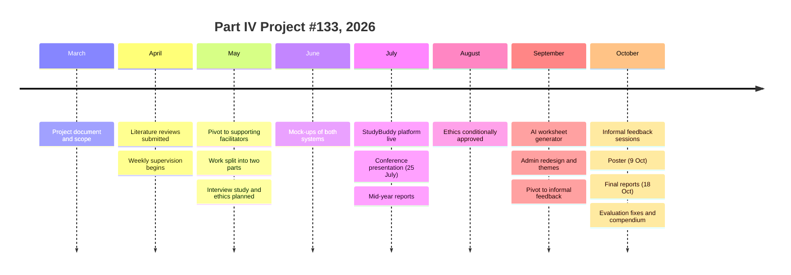
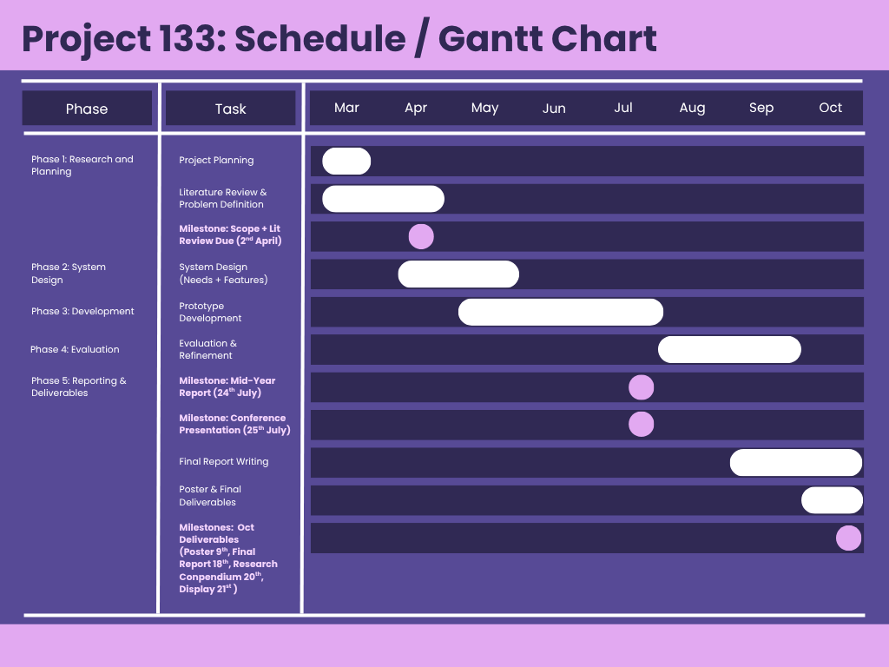

# Project Timeline

How Part IV Project #133 unfolded across 2026, built from the meeting minutes, the submission dates and the platform's commit history. Course deadlines are from the 2026 ECSE Part IV Project handbook.

## At a glance

## The original plan

The Gantt chart drawn up at the start of the project, in March. It held up well: the main change was that evaluation moved later and ran alongside final report writing in October.

## In detail

| Date | Milestone | Part | Evidence |
|---|---|---|---|
| March | Shared project document written: brief, scope, feature tiers, gap analysis | Joint | `Project-Document/` |
| March | Project scope assignment | Individual | `01-Submissions/01-Scope-and-Literature-Review` |
| Early April | Literature reviews submitted; both define six criteria for comparing models of education | Individual | `01-Submissions/01-Scope-and-Literature-Review` |
| 13 April | First minuted supervisor meeting | Joint | `Meeting-Minutes/` |
| April to May | Joint system design: literature gaps mapped to candidate features | Joint | `System-Design-and-Planning/` |
| 11 May | **Pivot:** from analysing student behaviour to supporting less experienced facilitators | Joint | Minutes, 11 May |
| 12 May | **Split:** Part 1, the platform (Moksh); Part 2, learner insights (May) | Joint | Minutes, 12 May |
| 20 to 25 May | Formal interview study designed; human ethics application started | Part 1 | Minutes; `03-.../07-Ethics` |
| 17 June | First mock-ups of the admin and facilitator sides (StudyBuddy) and of May's tool | Both | Minutes, 17 June |
| Late June | Project brief, design tokens and build sequence written for the platform | Part 1 | `03-.../06-AI-Use/for-code` |
| 7 July | May's student-side MVP demonstrated; StudyBuddy database complete | Both | Minutes, 7 July |
| 14 July | StudyBuddy platform deployed on Vercel; first commit | Part 1 | Git history, `9270afd` |
| 25 July | Conference presentation, Project #133 | Joint | `01-Submissions/03-Conference-Presentation` |
| 28 July | Conference feedback: evaluation strategy and the argument for non-teacher facilitators requested | Joint | Minutes, 28 July |
| Mid-year | Mid-year technical reports | Individual | `01-Submissions/02-Mid-Year-Report` |
| 27 August | Human ethics application (UAHPEC32076) conditionally approved, with conditions | Part 1 | `03-.../07-Ethics` |
| 14 September | AI worksheet generator built (replacing the mock); admin navigation restructured | Part 1 | Commits `7f4fd87`, `022ff8a` |
| 15 September | **Pivot:** formal interview study replaced by informal feedback chats | Part 1 | Minutes, 15 September |
| 15 to 25 September | Admin redesign: six styles compared, three themes kept, Canvas-style class cards; NZC Years 1 to 4 added alongside NCERT Grades 1 to 4; first heuristic review | Part 1 | `03-.../03-Design`, `06-AI-Use/for-design` |
| 20 September | Server region moved next to the database (Sydney), fixing slow pages | Part 1 | Commit `7a7ae3c` |
| 6 to 7 October | Informal feedback from an academic coordinator and a UI/UX reviewer | Part 1 | `03-.../02-Informal-Feedback` |
| 9 October | Display Day poster submitted | Joint | `01-Submissions/04-Display-Day-Poster` |
| 18 October | Final reports due | Individual | `01-Submissions/05-Final-Report` |
| 18 to 19 October | Technical evaluation run; second heuristic review | Part 1 | `03-.../05-Evaluation` |
| 19 October | Fixes from the heuristic review and the UI/UX feedback committed | Part 1 | Commits `a56a29c` to `98cf4c2` |
| 20 October | Research compendium submitted | Joint | This repository |
| 22 October | Part IV Display Day | Joint | |
| 27 October | Completion checklist | Joint | |
