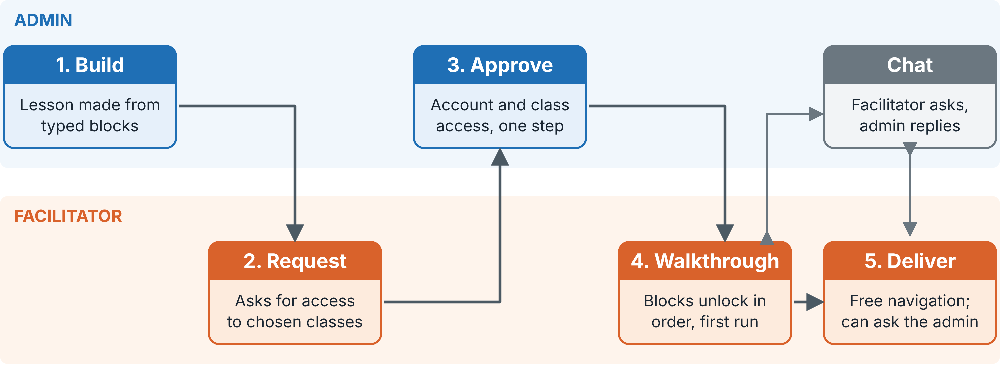
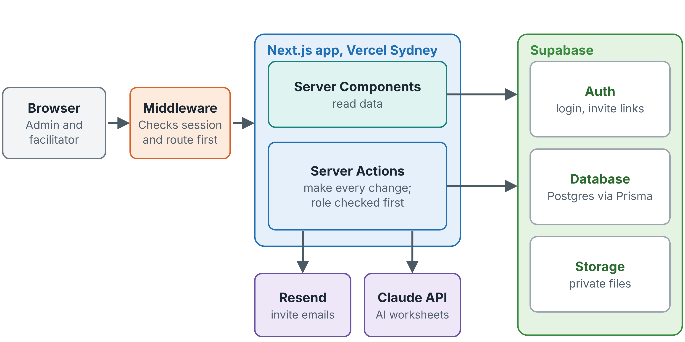
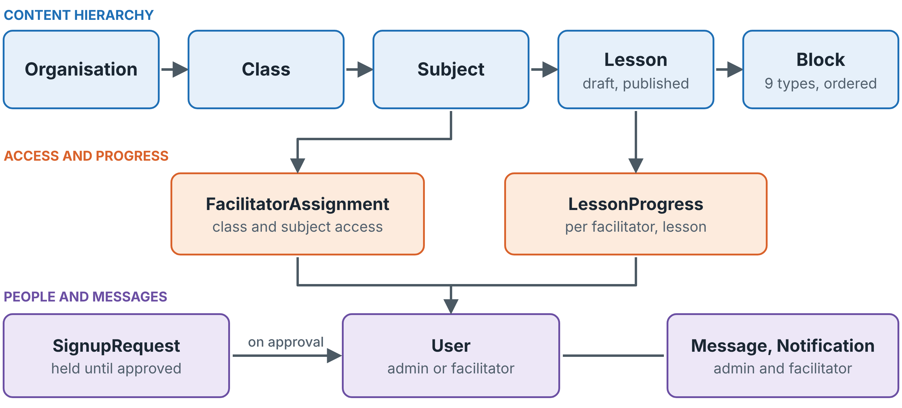
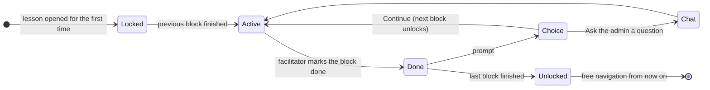
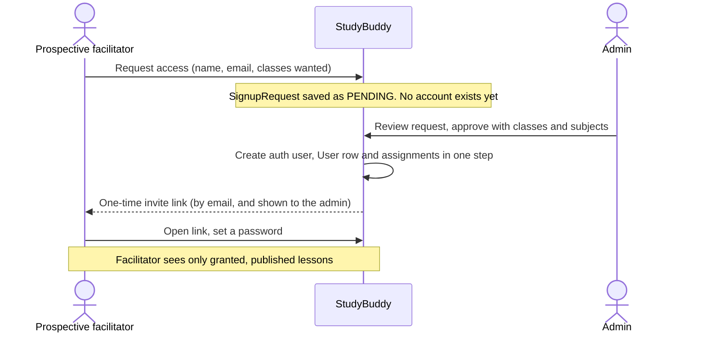
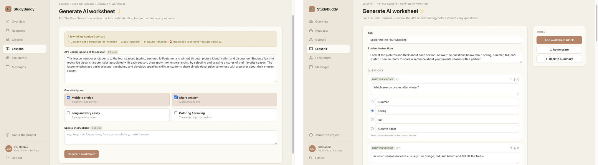

# 03 · Design

The design of the StudyBuddy platform: the principles it follows, how it is structured, how each core flow works, and why each major decision was made. This is the reference for anyone extending the platform. The working documents that produced this design (specifications, mock-ups, the six-style comparison and the redesign log) are in [`06-AI-Use`](../06-AI-Use/).

## Contents

1. [Design principles](#1-design-principles)
2. [The five-step flow](#2-the-five-step-flow)
3. [Architecture and technology](#3-architecture-and-technology)
4. [Data model](#4-data-model)
5. [Lesson authoring and block types](#5-lesson-authoring-and-block-types)
6. [Delivering a lesson: the walkthrough](#6-delivering-a-lesson-the-walkthrough)
7. [Access: request, approve, invite](#7-access-request-approve-invite)
8. [The AI worksheet generator](#8-the-ai-worksheet-generator)
9. [Interface design](#9-interface-design)
10. [Decision log](#10-decision-log)

---

## 1. Design principles

If an approved facilitator is to deliver a lesson as it was intended, **the expertise has to be built into the lesson and the platform, not supplied by the person delivering it.** Everything else follows from this.

- **Two roles.** Admins, who have teaching and subject expertise, create and organise lessons. Facilitators, who are with the students, deliver lessons but cannot edit them.
- **Quality is controlled at three points.** Screening (an admin approves each person before they get access), induction (the first pass through a lesson is locked step by step) and support (a chat from facilitator to admin during the walkthrough and delivery).
- **The server is the only source of truth.** Permissions and lesson progress are checked on the server, never trusted from the browser.
- **No student data.** Students have no accounts. Only admins and facilitators are recorded.

## 2. The five-step flow

1. An **admin builds** a lesson from blocks.
2. A **facilitator requests** access, choosing the classes they want to teach.
3. An **admin approves** the request and grants those classes in the same step.
4. The **facilitator walks through** the lesson once, each block unlocking after the one before it.
5. The **facilitator delivers** the lesson to the class and can move through it freely.

Content follows a fixed hierarchy that mirrors how a school organises teaching: **Organisation → Class → Subject → Lesson → Block.**

## 3. Architecture and technology

| Layer | Technology | Why |
|---|---|---|
| Web app | Next.js 14 (App Router), TypeScript | A facilitator needs only a browser. Server Components read data and Server Actions make every change, so each permission check sits next to the logic it protects, with no separate API layer |
| Route guard | Next.js middleware | Checks the session and route before a request reaches the app |
| Auth, database, storage | Supabase (Auth, Postgres, private Storage) | One vendor for three services: one integration to maintain |
| Database access | Prisma 6 | Typed queries and migrations. Pinned below version 7, which removed syntax the schema depends on |
| Email | Resend | Real invitation emails, so the approval flow can be tested end to end. The invite link is also shown to the admin, so approval works without email |
| AI | Anthropic Claude API (Haiku 4.5 and Sonnet 5) | The worksheet generator (Section 8) |
| Styling | Tailwind CSS with design tokens | One token layer drives all three themes |
| Hosting | Vercel, functions in Sydney (`syd1`) | Placing functions next to the database cut the time to add a block from about 10.7 s to about 434 ms |

An interactive architecture diagram from July is in [`06-AI-Use/for-design/system-architecture.html`](../06-AI-Use/for-design/system-architecture.html) (download and open in a browser).

## 4. Data model

Eleven models, defined in [`prisma/schema.prisma`](../04-Code/StudyBuddy-Platform/prisma/schema.prisma) with five migrations in [`prisma/migrations`](../04-Code/StudyBuddy-Platform/prisma/migrations/).

| Group | Models | Notes |
|---|---|---|
| Content | `Organisation`, `Class`, `Subject`, `Lesson`, `Block` | A lesson is `DRAFT` or `PUBLISHED`. A block has a type, an order and a JSON `content` field |
| People and access | `User` (role `ADMIN` or `FACILITATOR`), `FacilitatorAssignment`, `SignupRequest` | An assignment grants one class and subject. A sign-up request holds a person until approval, so no account exists before then |
| Delivery | `LessonProgress` | One row per facilitator per lesson; the walkthrough depends on it |
| Communication | `Message`, `Notification` | Between admins and facilitators only |

**Trade-off:** block content is one flexible JSON field instead of nine tables, one per block type. This keeps the model simple and easy to extend, at the cost of weaker compile-time checking of block content. The trade-off was accepted and documented in the code.

## 5. Lesson authoring and block types

A lesson is an ordered sequence of typed blocks. A single upload box would have been simpler to build, but it carries no guidance: typed blocks give each step the fields it needs, and their order tells the facilitator what to do and when.

| Block | Holds | Purpose in the room |
|---|---|---|
| Video | URL, duration | The expert teaching; embedded from YouTube (videos and playlists) |
| Workbook | Page reference, preview | Points students to the right page |
| Activity | Instructions | What the class does, and how |
| Worksheet | Uploaded or AI-generated file, answer key | Practice; printable |
| Reading | Text | Shared reading |
| Quiz | Questions | A quick check of understanding |
| Discussion | Prompts | Structured talk |
| Break | Duration | Pacing |
| Note | Facilitator-only text | Delivery instructions for the facilitator |

Lessons are built with a drag-and-drop builder (Report Figure 7), start as drafts, and can be edited or unpublished after publishing. A lesson plan in a `.csv` or `.xlsx` file can be imported directly. The platform was seeded with about 110 lessons from NCERT Grades 1 to 4 (India) and NZC Years 1 to 4 (New Zealand), in maths and science.

## 6. Delivering a lesson: the walkthrough

- On first opening, only block 1 is available. Each block unlocks only when the one before it is done.
- After each block, the facilitator chooses to **continue** or **ask the admin a question**.
- When every block is done, the lesson stays fully unlocked for delivery.
- State is **derived on the server** from one `LessonProgress` row (`currentBlockIndex`, `completedBlockIds`, `completedAt`). The content of locked blocks is never sent to the browser. A refresh or a new sign-in resumes at the same block.
- **Known weakness:** progress is stored as a position, so deleting a finished block mid-lesson can make a facilitator skip a step. See [`05-Future-Work-and-Handover`](../../05-Future-Work-and-Handover/).

## 7. Access: request, approve, invite

Open self-registration would give no control over who delivers lessons, so the platform uses **request first, invite later**. Every admin action calls a server-side role check (`requireAdmin()`); this was added after an early gap where admin pages were protected only in the interface. Uploaded files are stored privately and reached through signed links that expire after an hour.

## 8. The AI worksheet generator

The AI drafts and an admin approves, **twice**.

1. The generator reads the whole lesson, including YouTube captions and the text of uploaded PDF and DOCX files.
2. **Claude Haiku 4.5** writes a summary of what the lesson teaches, listing anything it could not read.
3. **Approval 1:** the admin corrects the summary and chooses question types.
4. **Claude Sonnet 5** writes the worksheet and answer key through forced tool use, so the output has a fixed structure that can be saved as a block.
5. **Approval 2:** the admin edits, regenerates or reformats, then adds it to the lesson as a new block. Nothing is ever overwritten.

With no API key configured the feature shows a "not configured" state and the rest of the platform is unaffected. Full specification: [`06-AI-Use/for-code`](../06-AI-Use/for-code/). Test results: [`05-Evaluation`](../05-Evaluation/) section D.

## 9. Interface design

The admin interface was redesigned in September 2026. Instead of committing to one idea, **six full mock-ups were built on the same real data** in different styles, and three were kept as switchable themes. Each theme is a set of design tokens (colour, radius, shadow, type) driving the same shared components. Class cards follow the Canvas course-card pattern because Canvas is the learning platform people are most likely to know. Emoji were replaced with icons that look the same on every system.

| Record | What it shows |
|---|---|
| [`studybuddy-mockup.html`](../06-AI-Use/for-design/studybuddy-mockup.html) | The first static mock-up (June) |
| [`style-explorer.html`](../06-AI-Use/for-design/style-explorer.html) | The six styles compared on the same data |
| [`admin-redesign-log.html`](../06-AI-Use/for-design/admin-redesign-log.html) | Each round of feedback, what changed and why |
| [`DESIGN_TOKENS.md`](../06-AI-Use/for-code/DESIGN_TOKENS.md) | The original token set |
| Report Figures 7 to 10 | The finished interface |

All HTML files are self-contained: download and open them in a browser.

## 10. Decision log

| Decision | Alternative considered | Why this one |
|---|---|---|
| Two roles, admins author and facilitators deliver | Facilitators adapt lessons | Facilitators are assumed to have no subject expertise, so instructional calls stay with the admin |
| Typed blocks in order | One upload or one long document | Order and type carry the guidance a facilitator would otherwise need expertise to supply |
| Locked first walkthrough | Free navigation from the start | Practitioners said nobody should enter a class unprepared |
| Progress held on the server | Progress in the browser | The order cannot be skipped by changing what the browser sends, and progress survives refreshes |
| Request first, invite later | Open sign-up | Control over who delivers lessons |
| Two approval steps for AI worksheets | Generate and publish | The admin's judgement checks the AI, and the summary catches misreadings before questions are written |
| JSON block content | One table per block type | Simplicity and extensibility, at the cost of weaker type checking |
| Prisma 6, not 7 | Upgrade | Version 7 removed syntax the schema depends on; stability first |
| Functions in Sydney | Default US region | Next to the database: about 25 times faster to add a block |
| No student data | Student accounts | Privacy, and a smaller ethical footprint for a proof of concept |
| Six mock-ups before choosing | One redesign | A choice made by looking, not guessing |
