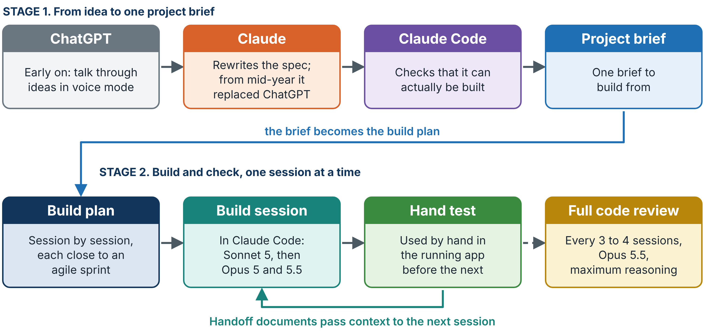

# 06 · AI Use

AI was used throughout Part 1: to refine ideas into specifications, to write most of the code, to produce design explorations, to build evaluation instruments and test harnesses, and to organise the writing. This folder keeps the material that was made with AI, **grouped by what it was made for**, so a reader can see exactly what the AI produced and where the human decisions sat. Report Chapter 7 describes the process; this folder is its evidence.

University of Auckland policy for this course permitted the use of AI without restriction.

## The pipeline

| Job | Tools tried | Kept |
|---|---|---|
| Writing code | Antigravity IDE, ChatGPT Codex, Claude Code | Claude Code |
| Refining ideas and requirements | ChatGPT (voice mode), Gemini, Claude | ChatGPT early on, then Claude alone from the mid-year report |
| Lesson material and the poster | Image and video tools | Not part of the build pipeline |

1. **Idea to specification.** The project context was talked through in ChatGPT voice mode to reach a first specification (problem, goals, how the system should work, what each page needs). Claude rewrote it thoroughly, and Claude Code checked it could be built. The result was one project brief.
2. **Specification to build plan.** The brief was broken into a session-by-session build sequence, each session close to a short agile sprint.
3. **Build and test.** Each session was built in Claude Code and tested by hand in the running app before the next began. Models: Claude Sonnet 5 at first, then Claude Opus 5 and Opus 5.5 as they were released.
4. **Review.** Every three to four sessions, a full code review was run with Claude Opus 5.5 at maximum reasoning, to find bugs that page-by-page testing missed.
5. **Context between sessions.** Structured handoff documents carried context from one session to the next, and every feature started from its own written specification.

## What was human and what was AI

| Decided by Moksh | Done mainly by AI |
|---|---|
| The admin and facilitator split; the five-step flow; approval before access; the locked walkthrough; the nine block types; the two approval steps of the worksheet generator; storing no student data; the direction of the admin redesign; what to keep, change or reject after every session | Writing most of the code; first drafts of designs; proposing options (including the six interface styles); building the evaluation harness and running it; first drafts of documents |

The contribution of Part 1 is therefore the design, the specifications and the testing of the platform, with AI as the main tool for implementation.

## Contents

| Folder | Made for | Contents |
|---|---|---|
| [`for-code/`](for-code/) | Building the platform | Project brief, build sequence, design tokens, original schema, feature specifications, engineering handoff |
| [`for-design/`](for-design/) | Deciding how it looks and works | First mock-up, the six-style explorer, the admin redesign log, the architecture diagram |
| [`for-evaluation/`](for-evaluation/) | Testing it | First heuristic review, UX feedback instrument; the test harness itself is in [`05-Evaluation`](../05-Evaluation/) |
| [`for-writing/`](for-writing/) | Writing the report and poster | Project journal, messaging and pitch, report writing brief |

**Reading the HTML files.** GitHub shows HTML as source. Download a file (or the repository) and open it in a browser to see it as intended. Each one is self-contained.

**Snapshots.** HTML files are snapshots of documents kept as live pages during the project, taken on 25 September 2026 or later.

## Guardrails

AI-written code can be fast and wrong. The checks that were built into the process:

- A written specification before every feature, updated as the code changed, so the record followed the system.
- A hand test of every session before the next.
- Periodic full code reviews.
- A separate technical evaluation of the finished system ([`05-Evaluation`](../05-Evaluation/)), because problems found during the build (invite links, dropped sessions, double submissions, interface-only protection) were found by using the system, not by the AI that wrote it.
- For literature, every paper suggested by AI was opened and checked by hand before use.
