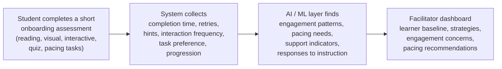
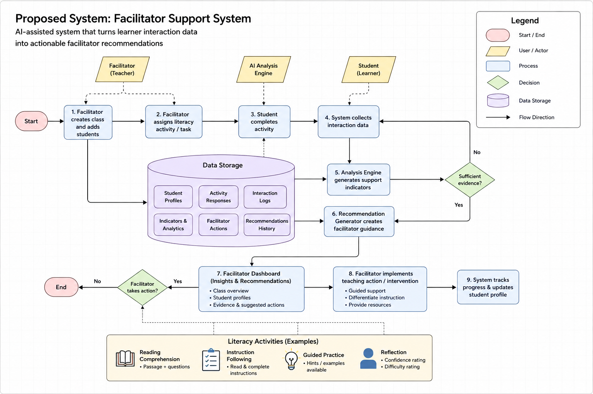

# Part 2 Research and Design Notes, April to July 2026

> **What this is.** May Thazin's working notes for Part 2, from the first learner-analysis idea in April to the design of the decision-support tool in July. It combines three documents from the project's shared Google Drive:
>
> | Section | Source document | Last edited |
> |---|---|---|
> | 1 | *SOFTENG 700A: System Design and Planning*, Tab 2 (Tab 1 is joint and stays in [`02-General/System-Design-and-Planning`](../../02-General/System-Design-and-Planning/)) | April to May 2026 |
> | 2 | *Educational Design and AI-Supported Facilitator Systems* | 10 June 2026 |
> | 3 | *SOFTENG 700A: Student Facilitator Tool* | 24 July 2026 |
>
> Combined and tidied on 20 October 2026. The ideas, lists and tables are kept. Repeated summaries were merged, wording was tidied (British spelling), scheduling notes were removed, and planning advice that was addressed to the reader was rewritten in a neutral voice. Section 4 was added to show which ideas reached the final tool.

## Contents

1. [April to May: analysing how students learn](#1-april-to-may-analysing-how-students-learn)
2. [June: an AI-supported facilitator system](#2-june-an-ai-supported-facilitator-system)
3. [June to July: the student and facilitator tool](#3-june-to-july-the-student-and-facilitator-tool)
4. [What carried through to the final tool](#4-what-carried-through-to-the-final-tool)

## How the thinking developed

| When | Direction | Prompted by |
|---|---|---|
| April | Use AI to analyse students' learning styles before classes start | A conversation with a person in the education field |
| 11 to 12 May | Support less experienced facilitators rather than analyse students for their own sake; Part 2 takes the learner-analysis and AI side | Supervisor meeting (11 May pivot) and the work split (12 May) |
| 20 May | Narrow the scope to the analysis and software side; assume students have devices | Supervisor meeting |
| June | A learner-readiness assessment at the start of term, with behavioural indicators instead of learning styles | Literature and discussions with teachers |
| 17 June | A system design with scope and goals; a 5 to 10 minute check before each lesson instead of a one-off assessment; reading comprehension | Supervisor meeting |
| June to July | One subject (literacy), older primary children, five learner dimensions, success criteria, the final research question | Conversation with Anthony Feng; supervisor meetings |
| 14 July | Machine-learning pipeline over the five dimensions | Team meeting |

Dates come from the meeting minutes in [`02-General/Meeting-Minutes`](../../02-General/Meeting-Minutes/).

---

## 1. April to May: analysing how students learn

*From System Design and Planning, Tab 2.*

**Starting idea.** Build on the idea of helping to analyse students' behaviours. A person in the education field suggested using the tool to analyse learning styles at different ages, because learning styles and capabilities vary widely across K–12. It could run as a preliminary assessment before classes start, so the teacher or facilitator can work with what suits each child best, with a separate assessment for each age band (Years 1 to 2, 3 to 4, 5 to 6, 7 to 8, and so on).

**Core idea of the feature.** Use AI to help facilitators understand how students learn best before and during lessons.

- Connects to: reducing teacher load; personalisation for students
- Possible features: student profiling, engagement tracking, anomaly detection, suggestions for the facilitator

**Relation to the project's purpose.** Support facilitators to deliver more effective, personalised learning by using AI to identify students' learning behaviours, engagement patterns and preferred approaches.

**Measurements considered.**

| Kind | Measures |
|---|---|
| Behavioural engagement | Time on task (s), activity completion (%), participation frequency (%), interaction count, response rate (%) |
| Cognitive engagement (proxies) | Retry attempts, hint use, question depth, revision frequency |
| Self-regulated learning | Indicators to be defined |

**Existing tools reviewed.** TeachLens (AI lesson observation), Vizenta AI (Class Engage AI), GIANTY (AI classroom analysis).

**Reframed purpose.**

- Help non-expert facilitators adapt lessons for mixed-ability classrooms where formal educational support may be limited
- Indicate how much support a student may need and what they would benefit from
- Improve accessibility by helping facilitators prepare for the class they are about to teach

**Sources noted.** Homeschooling NZ, curriculum and qualifications: <https://homeschoolingnz.org/curriculum-qualifications/>. A. English, "Assessing the role of exposure to learning styles theory on K-12 teachers," *Teacher Education Quarterly*, vol. 48, no. 4, pp. 78–96, 2021. <https://www.jstor.org/stable/27099523>

---

## 2. June: an AI-supported facilitator system

*From Educational Design and AI-Supported Facilitator Systems.*

### 2.1 Aim and audience

**Working summary.** A facilitator-support platform that uses lightweight, AI-assisted analysis of learner interactions to improve structured educational delivery in underserved K–12 settings.

**Audience.** Facilitators and teachers who need more support in teaching.

**Aim of this stage.** Define how the educational system should work, why it should work that way, and how AI can support facilitators responsibly: the educational logic, facilitator workflows, reasons for using AI, user needs, and research-backed design decisions.

### 2.2 The problem

The focus is how a facilitator-supported system should work in underserved and lower-resource K–12 settings. Rather than AI-driven teaching, the aim is to see how technology can help facilitators deliver more structured, consistent and accessible learning.

The literature review and discussions with stakeholders point to a shortage of qualified teachers and uneven quality, especially in rural and lower-income communities. Facilitators or parents often teach subjects outside their expertise, which leads to inconsistent delivery and low confidence. Existing AI tools assume students can direct their own learning, but younger learners need much more structure and guidance.

| Current issues | Where current systems fall short | What the system should do |
|---|---|---|
| Teacher shortages | Younger learners need structure | Guide facilitators |
| Inconsistent delivery | Facilitators lack confidence | Provide structured lessons |
| Little support for facilitators | AI tools assume self-directed learning | Reduce uncertainty |
| Low-resource settings | Curriculum delivery is inconsistent | Support mixed-ability classrooms |
| Mixed-ability classrooms | | Use AI carefully |

The system is therefore designed around structured delivery and facilitator support, not autonomous AI teaching.

### 2.3 The role of AI

AI should be a lightweight support that helps facilitators understand and respond to classroom needs. It should not replace facilitators or make educational decisions on its own. Questions to answer: where AI helps, where it should not be used, what its ethical limits are, and how humans stay in charge.

The working concept was an **AI-assisted facilitator support and learner readiness system**: help facilitators quickly understand students' support needs before and during a term, especially in mixed-ability or low-resource classrooms. Following teachers' and outside views, it would look for **behavioural and engagement indicators** rather than fixed "learning style" categories.

### 2.4 Proposed prototype: a learner-readiness assessment



At the start of term, students complete short activities suited to their age: reading, visual, interactive, pacing-based and simple problem-solving tasks. The outputs would **not diagnose or label students**. They would give facilitators practical, interpretable suggestions, for example:

- students who need shorter blocks of instruction
- students who would benefit from guided examples
- groups that need more pacing support

### 2.5 Machine-learning options

| | |
|---|---|
| Inputs | Behavioural metrics and activity interaction data from the onboarding activities |
| Possible models | Clustering to group students with similar patterns; simple classifiers; a recommendation engine for facilitator suggestions |
| Outputs | Learner support profiles and facilitator suggestions |
| Requirement | Interpretable outputs that support the facilitator, not an opaque or autonomous system |

### 2.6 Design priorities

- Structured, facilitator-guided learning
- Accessibility in underserved settings
- Ethical use of AI
- Lightweight tools that reduce facilitator workload without removing human oversight

AI stays a supporting tool, not the main driver of teaching.

### 2.7 Research areas

| Area | What to research | Questions |
|---|---|---|
| Facilitator decisions | Formative assessment, teacher decision-making, classroom interventions, mixed-ability classrooms, differentiation | What decisions do facilitators make? What would help a less experienced facilitator? How do teachers spot struggling students, adapt lessons, and what indicators and interventions do they use? |
| Learning analytics | Learning analytics, educational data mining, engagement analytics, classroom analytics | What interaction data is usually collected? Which metrics are meaningful, and which are ethical? Examples: completion time, attempts, retries, hints, task completion, progression |
| Explainable AI in education | Explainable AI, human-in-the-loop AI, decision-support systems, ethics of AI in education | How are recommendations explained? How are black-box decisions avoided? How does the facilitator stay responsible? Goal: the system gives recommendations, not decisions |
| Intervention strategies | Scaffolding, worked examples, mastery learning, differentiated instruction, cognitive load theory | |
| Baseline assessment | Diagnostic assessment, learner readiness, baseline testing | Which activities, how long should onboarding take, and what can realistically be measured? |
| Facilitator dashboard | Teacher dashboards and learning analytics dashboards (Moodle, Canvas, Khan Academy) | What should a facilitator take in within 30 seconds? |

**Planned baseline tasks.**

| Task | Measures |
|---|---|
| Reading task | Comprehension, pace |
| Quiz | Accuracy, confidence |
| Guided task | Hint use |
| Problem-solving task | Persistence |

**Dashboard sketch.**

- **Class overview:** students needing support, students progressing normally, students needing more challenge
- **Student card:** strengths, support needs, recent trends, recommended actions
- **AI assistant** answering: Who needs support? What should I focus on today? Which students are disengaged?

### 2.8 Questions for the supervisor

1. Should the project identify learner needs, recommend interventions, or both?
2. Is the main contribution the analytics layer, the facilitator workflow, or the recommendation system?
3. Is a rule-based recommendation engine enough for the prototype, or should machine learning be investigated?
4. Should the onboarding assessment be a one-off diagnostic, or should data be collected throughout the term?
5. What would make a facilitator-support recommendation successful from an educational point of view?

### 2.9 Scoping notes

- Focus on the design and concept, and go deep into one area rather than spreading thin; constrain the problem to something reasonable (quality over quantity).
- Interfaces: teacher and student, kept separate. Most classrooms have computer labs or phones.
- Work out how this side integrates with Moksh's side: two parts of the same problem.
- Research good practice and try ideas out.
- Skills this involves: requirements elicitation, stakeholder analysis, system architecture, AI integration, data pipelines, dashboard design, explainable recommendations, human–computer interaction, and evaluating how useful software is.

### 2.10 Next steps (June)

1. Define the onboarding activities for each age group.
2. Decide which interaction metrics are most useful and ethical to collect.
3. Design the outputs and recommendations.
4. Choose the machine-learning approach.
5. Design how facilitators see and use the results.

**Related tools seen at an industry expo.** Linewise, supported by Qoria (digital safety for children); Saasyan (AI-powered student safety for K–12 schools); KaiLab (teaching coding to students).

---

## 3. June to July: the student and facilitator tool

*From SOFTENG 700A: Student Facilitator Tool.*

### 3.1 Direction

The project explores how software can help facilitators, especially less experienced ones, understand learner needs. Rather than using AI to teach students directly, it investigates how learner interaction data can become actionable insights and recommendations: an **AI-assisted facilitator decision-support system** that helps facilitators see which students may need more support, pacing changes or a different approach.

| Problem | Current idea |
|---|---|
| Teacher shortages; inconsistent delivery; mixed-ability classrooms; facilitators may lack teaching expertise | Students complete activities. The system collects completion times, retries, hints, progression and engagement indicators, then produces learner summaries, support indicators, recommendations, and prompts the facilitator can use with each student |

### 3.2 Proposed system

<p align="center"></p>

The facilitator creates a class and assigns a literacy activity (reading comprehension, instruction following, guided practice with hints, and a reflection with confidence and difficulty ratings). The system collects interaction data and generates support indicators. When there is enough evidence, it creates guidance for the facilitator, who sees a class overview, student profiles, and evidence with suggested actions. The facilitator decides whether to act, and the system tracks progress and updates the profile.

### 3.3 Conversation with Anthony Feng

Anthony Feng's research uses simulated students to benchmark educational systems. The central open question at this stage was how to model learning and teaching: the step between a student's activity and a recommendation for the facilitator.

```text
Student  ->  Learning behaviour  ->  Interpretation  ->  Facilitator action
```

**Questions prepared.**

1. **Representing a learner:** how is a student represented, and what information models their learning?
2. **Signals of learning:** which indicators show learning is happening (task completion, mistakes, retries, improvement over time, confidence)?
3. **Level of abstraction:** is the learner model about individual behaviours, skills, competencies, or something else?
4. **Avoiding educational assumptions:** how does the system avoid conclusions the evidence does not support?
5. **Useful explanations:** how are outputs made interpretable to users?
6. **Scope:** which ideas turned out too large or too hard to justify?

**Notes from the conversation.**

- **Purpose of a student model:** real student performance is hard to test reliably, so a simulated student model can check whether a test or system assesses students well.
- **Approach:** benchmarking with simulated students (OpenClaw), using the OpenAI API for prompts and responses only. A knowledge base built from curriculum data acts as the "brain" of the student, queried through retrieval-augmented generation (an LLM with a database), with prompt engineering. Data came from the VCE curriculum (Victoria, Australia, final year of secondary school), whose reports give the number of students at each grade. The AI model answers every exam question and a marking agent marks them. Parameters: correctness on multiple-choice questions, and short-answer questions.
- **Agentic systems** set goals and make step-by-step plans. Open learner models let students examine their own learning. The educational system is the interaction between the human, the system and the student model.
- **Assessing during learning:** exam results are not the best measure; intermediate working and feedback from learning are more informative, especially in mathematics.
- **Caution:** the full approach is too complex for a one-person project.

**Questions this raised for Part 2.**

- Students: how will they be assessed, and how can feedback from their intermediate work be used?
- Facilitators: how will the tool help them, and with what materials?

### 3.4 Scope decision

Focus on **one subject and age group: literacy**, which is fundamental, for **older primary children**, where more reasonable assumptions can be made.

| For students: learner readiness for independent learning | For facilitators |
|---|---|
| Reading comprehension; instruction following; persistence and self-determination; help-seeking and reaction to feedback; confidence | Help them tell whether a student does not understand the content or does not understand the instructions (reading comprehension versus instruction following) |

### 3.5 Purpose of the MVP and the research question

**Purpose of the MVP.** Show that learner interaction data can be turned into meaningful, explainable recommendations that support facilitator decisions. The MVP evaluates the workflow, system design and concept, not educational outcomes.

**How the research question was refined.**

1. *Can a software system collect learner interaction data and present it in a way that helps facilitators understand student support needs?*
2. *Can learner interaction data be used to generate evidence-based recommendations that support facilitator decision-making?*
3. **Can a software system convert learner interaction data into evidence-linked recommendations for facilitator decision-making?** (the final question)

### 3.6 Proposed success criteria

Four areas to assess: **data collection** (can meaningful learner behaviours be captured?), **learner modelling** (can the system identify support needs?), **recommendation quality** (can it produce explainable guidance?), and **decision support** (does it support facilitator decisions?).

| Criterion | Purpose | Measurement | Success condition |
|---|---|---|---|
| Learner data collection | Capture meaningful interactions | Check that completion time, retries, hints, confidence and accuracy are recorded correctly | 100% of required metrics stored |
| Behavioural analysis | Turn interaction data into behavioural indicators | Run predefined learner scenarios | Expected indicators for every scenario |
| Recommendation generation | Produce facilitator guidance | Compare recommendations with expected outputs | Recommendations for every test scenario |
| Recommendation explainability | Back every recommendation with evidence | Check each recommendation refers to observed behaviour | Every recommendation has supporting evidence |
| Decision-support coverage | Address the intended facilitator decisions | Map recommendations to facilitator needs | All identified decision categories supported |
| Progress tracking | Monitor change over time | Simulate several activity sessions | Profile updates reflect progress |
| Class-level analysis | Show class-wide trends | Create a multi-student test dataset | Class-wide patterns identified correctly |
| Transparency | Avoid unsupported conclusions | Review generated outputs | No diagnoses or unsupported educational claims |
| End-to-end function | The full workflow works | Run from activity completion to recommendation | Every stage completes |

### 3.7 Machine-learning approach

The question the model answers for a facilitator: *"How should I best support this student?"*

| Dimension | Meaning | Measurements | Derived metric |
|---|---|---|---|
| Independence | Completing tasks without support | Hint count, passage revisits, time before first interaction, attempts | Independence score (0–100) |
| Reading comprehension | Understanding the text | Question accuracy, question difficulty, reading time, patterns in wrong answers | Comprehension score |
| Confidence calibration | Match between confidence and performance | Confidence ratings, accuracy | Calibration index |
| Help-seeking | How support is used | Hint timing and frequency, passage revisits after hints | Help-seeking profile |
| Task processing | Understanding and following instructions | Reading time before starting, first-interaction delay, revisits to instructions or passage | Task-processing score |

The dimensions should be extensible and work for individuals and the whole class. Candidate models: decision trees (explainable) and XGBoost (often slightly more accurate).

**Staged plan.**

| Stage | Steps |
|---|---|
| 1. Working pipeline | Finalise the five dimensions; define measurable features; log events; build the feature extractor; implement rule-based classifications; show evidence and actions on the dashboard |
| 2. ML prototype | Create labelled scenarios; export the feature dataset; train decision trees; evaluate against the rule baseline; save the models; create a prediction API |
| 3. Explainable assistance | Return prediction confidence; extract the most influential evidence; generate cautious facilitator actions; show evidence, inference and action separately |
| 4. Future validation | Gather ethically approved real data; replace synthetic labels with expert-reviewed ones; retrain and recalibrate; study whether facilitators find the outputs useful |

**Planned pipeline.**

1. The student completes a literacy activity.
2. The app records interaction events.
3. A feature extractor calculates behavioural metrics.
4. Rules or a model infer the five support dimensions.
5. An explanation layer selects the supporting evidence.
6. A recommendation layer maps dimensions to possible actions.
7. The dashboard shows the observation, inference, evidence and suggested action.
8. The facilitator makes the final decision.

### 3.8 Future idea: webcam gaze signals (not built)

Gaze tracking was considered as an optional future signal, not part of the MVP. With Year 3 to 6 children it would need strong consent, privacy safeguards and probably ethics approval.

| Possible signal | What it could show |
|---|---|
| Time looking at the question, passage or answer options | Where the student spends effort, e.g. "repeatedly returned to the question before answering" |
| Looking away for long periods | A weak engagement signal, not evidence of understanding |
| Returning to the question area | Possible uncertainty about what to do |
| Scanning all options or fixing on one quickly | Could support a prompt to compare all options |

A light version would split the screen into regions and estimate gaze direction roughly in the browser, process it locally, store only derived metrics (such as `questionDwellMs`, `passageDwellMs`, `answerDwellMs`, `lookAwayCount`), never store video, and avoid identity recognition. The MVP uses interaction-based proxies instead; gaze could later help tell whether a difficulty is with the instructions, attention or the content.

---

## 4. What carried through to the final tool

| Idea in these notes | In the final tool and report |
|---|---|
| Learning-style assessment (Section 1) | Dropped in favour of observable behavioural signals |
| One-off onboarding assessment at the start of term (2.4) | A 5 to 10 minute reading check before or after each session, building a baseline over time (Report Section 1.3) |
| Several activity types for many ages (2.4, 2.7) | One activity type, reading comprehension, for Years 3 to 6 (3.4) |
| Telling content difficulty from instruction difficulty (3.4) | The task-understanding indicator, separate from the accuracy indicator |
| Five learner dimensions (3.7) | 17 session metrics from reading-comprehension research, such as literal and inferential accuracy, overconfidence on errors and pre-attempt hints ([`02-Design`](../02-Design/)) |
| Confidence ratings (2.7, 3.7) | Confidence plus a postdictive "did you get it right?" judgement after each answer |
| Rules first, then a model (3.7, stages 1 and 2) | Rules v2 are the decision mechanism; Random Forests were evaluated against them and, without real labels, only copied the rules ([`04-Evaluation`](../04-Evaluation/)) |
| Evidence, inference and action shown separately (3.7) | Each indicator shows "What we saw" and "What this can mean", with a suggested next step |
| Predefined learner scenarios (3.6) | 200 simulated classrooms built from five reader profiles |
| Class-level analysis (3.6) | Class-pattern alerts |
| Progress tracking (3.6) | Attempt history and pooling of the last three passages; trend views are future work |
| AI assistant on the dashboard (2.7) | Not built |
| Webcam gaze signals (3.8) | Not built; future idea only |
