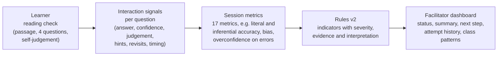
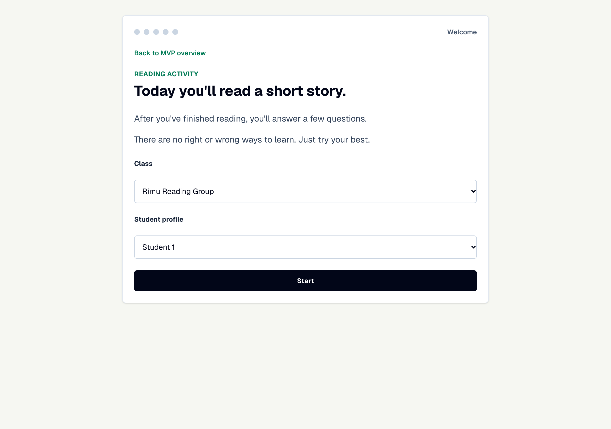
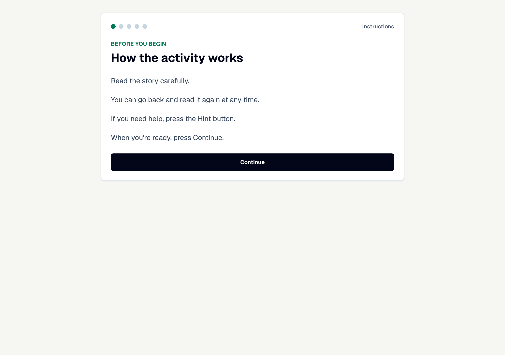
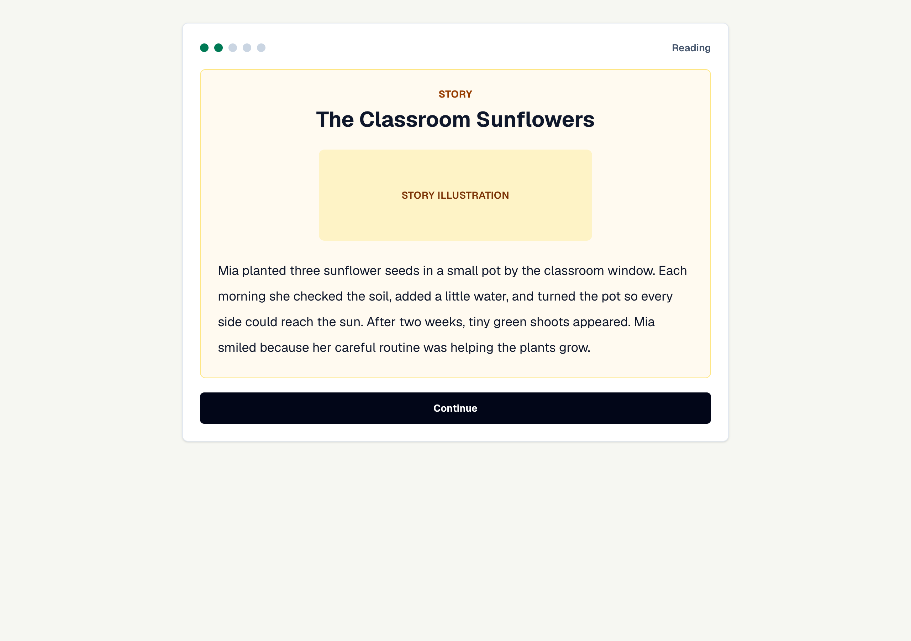
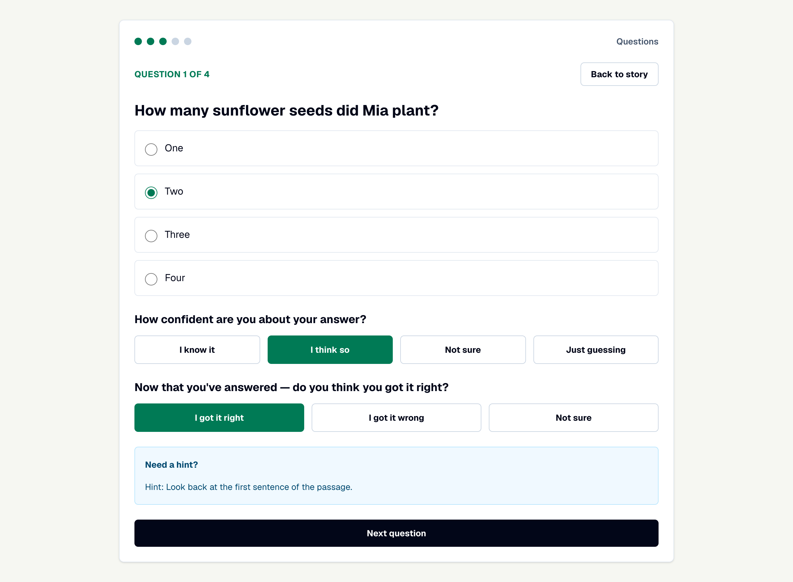
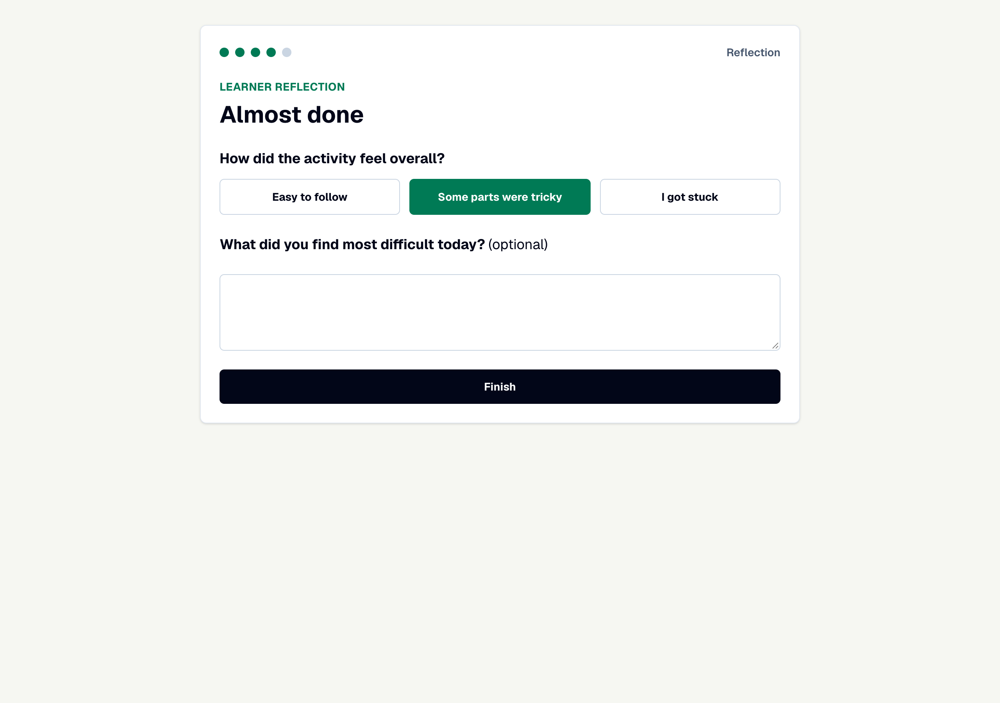
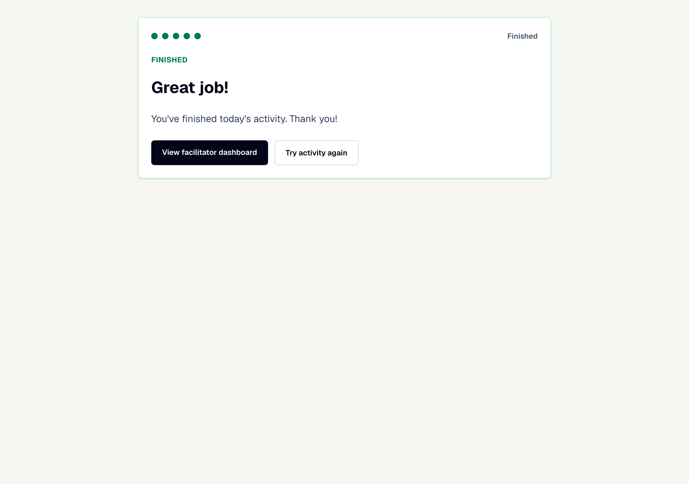

# 02 · Design

How the facilitator decision-support tool is put together: the pipeline, the reading check learners complete, the data it records, the rules (v1 and v2) that turn that data into a status, and the facilitator dashboard. This supports **Sections 1.3 and 3.1 to 3.4 and 3.8** of May's final report. The rules and thresholds are also listed in full in **Appendix A.2** of the report.

The source of truth for everything on this page is the code in [`../03-Code/partIV-facilitator-decision-support/facilitator-decision-support/src/`](../03-Code/partIV-facilitator-decision-support/facilitator-decision-support/src/). File paths below are relative to that folder.

---

## 1. Pipeline (Report Figure 3.1)

| Stage | Where in the code |
|---|---|
| Reading check | `features/student/StudentActivity.tsx`, passages and questions in `features/student/activityContent.ts` |
| Signals and data model | `shared/types/activity.ts` (`StudentResponse`, `QuestionResponse`), saved by `shared/storage/activityResults.ts` |
| Session metrics | `computeSessionMetrics()` in `features/analytics/recommendationEngine.ts` |
| Rules v2 | `generateRecommendation()` in the same file |
| Class patterns | `detectClassPatterns()` in the same file |
| Dashboard | `features/facilitator/FacilitatorDashboard.tsx`, demo learners in `features/facilitator/demoData.ts` |
| CSV export | `shared/export/exportResultsCsv.ts` (same columns as the evaluation's per-learner CSVs) |

Two design principles (Report Section 3.1):

1. **Evidence-linked.** Every flag shows the raw counts behind it, not just a label, because a less experienced facilitator needs to know *why* before acting.
2. **Support, not replace.** Transparent rules are the decision mechanism. A Random Forest was evaluated alongside them (see [`04-Evaluation`](../04-Evaluation/)) but is not in the app.

## 2. Requirements (Report Table 3.1)

| Gap in the literature | Requirement | Implemented as |
|---|---|---|
| Dependence on teacher expertise | R1. Help a non-specialist facilitator decide who needs support and what to do next | Status per learner, plain-language interpretation, suggested next step |
| Lack of structured guidance | R2. Keep the learner's task short, linear and guided | Fixed sequence: welcome, instructions, passage, four questions, reflection |
| Personalisation without delivery | R3. Point to the *type* of difficulty, not just its size | Separate literal and inferential accuracy; distinct indicators |
| Teachers miss poor comprehenders | R4. Detect fluent readers with weak inference and overconfidence | Comprehension-pattern rule (inferential gap plus overconfidence on errors) |
| Trust in analytics | R5. Every flag shows its evidence | Each indicator stores the counts that triggered it |
| Variable delivery quality | R6. Separate learner problems from material problems | Class-pattern alerts |
| Adaptability across contexts | Out of scope | Future work |

## 3. The reading check (learner side)

Three short narrative passages for Years 3 to 6: *The Classroom Sunflowers*, *The New Student* and *The Rainy Day Plan*. Each has two literal and two inferential multiple-choice questions. One check takes 5 to 10 minutes and is meant to be repeated each session, so evidence builds up per learner.

| Screen | What is recorded |
|---|---|
|  | Class and learner chosen from the facilitator's roster |
|  | Nothing; plain instructions only |
|  | Reading time |
|  | Answer and every change to it, confidence (1 to 4), postdictive judgement ("do you think you got it right?"), hints and whether one came before any answer, passage revisits, time to first interaction, time on question, and whether a hint was followed by a repair (reread or revision) |
|  | Perceived difficulty (1 to 3) and an optional comment |
|  | Session saved to browser local storage |

Each design choice is tied to a reading-comprehension finding (Report Table 3.2): literal and inferential questions are scored separately because the two develop on different paths; the postdictive judgement follows the method shown to separate children with comprehension difficulties; hints are split into before and after a first attempt because pre-attempt hints are the stronger struggle signal; and answer changes are not counted as struggle on their own because most changes go from wrong to right.

## 4. Session metrics (Report Table 3.3)

| Metric | Definition |
|---|---|
| Accuracy (overall, literal, inferential) | Share correct, overall and by question type |
| Inferential gap | Literal accuracy minus inferential accuracy |
| Bias score | Mean of (judged correctness minus actual correctness); judgement "correct" = 1, "unsure" = 0.5, "incorrect" = 0. Positive means overconfident |
| Overconfidence on errors | Share of wrong answers the learner judged "correct" (`oc_err_rate` in the Python evaluation) |
| Accurate estimations | Answers judged correct that were correct, plus answers judged incorrect that were wrong |
| Pre-attempt hints | Hints requested before any answer was selected |
| Repairs | Questions where a hint was followed by a reread or a revision |
| Processing signals | First-interaction delay, question time, passage revisits, answer changes |

The same definitions are implemented in TypeScript (`computeSessionMetrics()`) and Python (`session_features()` in the evaluation script), so the simulation measures the logic the app runs. There is no automated parity test between the two; that is listed as future work.

## 5. Rules v2

Each rule produces an **indicator**: a severity, the evidence that triggered it, and an interpretation. A learner's status is their highest severity.

| Severity | Shown as |
|---|---|
| High | **Needs support** (red) |
| Medium | **Worth a check-in** (amber) |
| Low only | **On track** (green), with the low indicators shown as context |

| Indicator | Rules v1 (first version) | Rules v2 (evaluated and in the app) |
|---|---|---|
| Processing difficulty | Any one of: first delay ≥ 20 s, answer changes ≥ 2, revisits ≥ 2, question time ≥ 75 s, pre-attempt hints ≥ 1. Medium if accuracy ≥ 75%, else high | **Two or more** of: first delay ≥ 20 s, revisits ≥ 2, question time ≥ 75 s, answer changes ≥ 3, pre-attempt hints ≥ 1, pre-attempt hints ≥ 2. Medium if accuracy ≥ 75%, else high |
| Accuracy | Any miss: medium; below 50%: high | Below 50%: high; 50 to 74%: medium; 75 to 99%: low |
| Hint use | One hint: low; more: medium | Low note only |
| Low confidence | Any answer rated 1 or 2: medium | Two or more answers rated 1 or 2: medium |
| Perceived difficulty | Rated 3: medium | Rated 3 **and** accuracy below 75%: medium |
| Miscalibration | Bias ≥ 0.4: medium; ≥ 0.7: high | Bias ≥ 0.4: medium |
| Comprehension pattern | Gap ≥ 0.34: medium | Gap ≥ 0.5 (one passage) or ≥ 0.34 (last three passages pooled): **high if overconfidence on errors ≥ 0.5**, otherwise low |
| Self-regulated recovery | | Repair after a hint and accuracy ≥ 75%: low (a positive sign) |
| Extended time | Total time > 240 s: medium | Low note only |

Each status also gets a one-sentence summary and a suggested next step, chosen in this order: comprehension pattern, task understanding, content, miscalibration, self-efficacy, ready to continue. For example, the comprehension pattern gives *"Pick one inference question and ask 'How do you know?'"*.

**Class patterns** (R6): for each passage, using each learner's latest attempt, an alert is raised when at least three learners, and at least half of those who attempted it, miss the same question or show the same inferential gap. That points to the passage or question rather than to individual learners.

**Thresholds are prototype defaults, not validated cut-offs.** The pooled threshold of 0.34 has a known granularity problem: over six inferential questions the gap moves in steps of 1/6, so 2/6 (0.333) falls just below 0.34 and the pooled rule behaves like 0.5. See [`04-Evaluation`](../04-Evaluation/) and [`05-Future-Work-and-Handover`](../../05-Future-Work-and-Handover/).

## 6. Facilitator dashboard

The dashboard groups attempts into a support profile per learner, sorted by most recent attempt, with summary counts at the top. Facilitators can add classes and students, filter by class, export sessions or questions as CSV, and load seven anonymous demo learners whose sessions follow the evaluation personas. The demo recommendations come from the real engine, so the screenshots show genuine rule output.

| Screenshot | What it shows |
|---|---|
| [`01-home.png`](screenshots/01-home.png) | Landing page: the four-step pipeline and the two entry points |
| [`08-dashboard-overview.png`](screenshots/08-dashboard-overview.png) | Dashboard header: exports, demo data, summary counts, class view, adding classes and students |
| [`09-learner-A-needs-support.png`](screenshots/09-learner-A-needs-support.png) | **Learner A** (poor-comprehender profile): *Needs support* from the comprehension-pattern rule pooled over three passages. This is the learner in Report Figure 3.2 and the Section 4.7 walkthrough. A score threshold would not flag them (75% is not below 75%) |
| [`10-learner-C-task-understanding.png`](screenshots/10-learner-C-task-understanding.png) | **Learner C** (decoding-limited profile): *Needs support* from five converging processing signals, with hint, confidence, difficulty and time notes |
| [`11-learner-E-check-in.png`](screenshots/11-learner-E-check-in.png) | **Learner E**: *Worth a check-in* from 50% accuracy and miscalibration |

## 7. Implementation notes

- **Stack:** Next.js 16, React 19, TypeScript and Tailwind CSS 4. Icons from `lucide-react`.
- **Storage:** browser local storage only, so the prototype is self-contained and holds no data on a server. This is not suitable for real learner data, which would need authentication, server-side storage and privacy safeguards (Report Section 5.4).
- **No identifiers** beyond the name a facilitator types in. The demo learners are anonymous.
- **Screenshots** were taken on 20 October 2026 from a local `npm run dev` build at 1280 × 900 with "Load demo data", so dates in them are relative to that day.

## Design history

| When | Change | Evidence |
|---|---|---|
| June 2026 | Research into educational design and facilitator systems; reading comprehension chosen as the skill | [`01-Research`](../01-Research/) |
| July 2026 | Base student and facilitator flows; activity layout changed for cognitive load and data collection; reflection added; persistent attempts; classes and students | [`COMMIT-HISTORY.md`](../03-Code/COMMIT-HISTORY.md), mid-year report |
| August to October 2026 | Planned a Random Forest as the main mechanism. While the final report was being finished (mid-October), the results showed a model trained on rule labels only copies the rules, so the transparent rules became the decision mechanism and the Random Forest a comparison | Report Sections 3.1, 4.4; the draft report in the shared Drive still shows the earlier plan |
| October 2026 | Rules v2, demo data, CSV export and the simulated-classroom evaluation | [`04-Evaluation`](../04-Evaluation/) |
