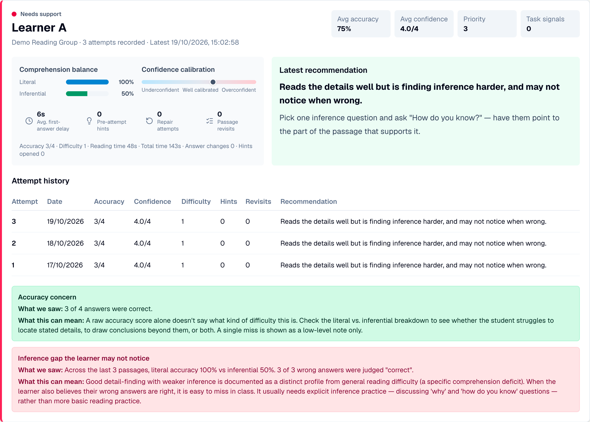

# Part 2 · Student Learning Insights (Facilitator and Student)

**May Thazin** · `mtha724` · Final report: [*Making Education More Accessible & Reliable: AI-Driven Facilitator-Based Teaching*](../01-Submissions/05-Final-Report/May-Thazin/Final-Report_May-Thazin.pdf), facilitator–student side (18 October 2026)

## The research question

> Can a software system convert learner interaction data into evidence-linked recommendations for facilitator decision-making?

Applied to Year 3 to 6 reading comprehension, with three sub-questions:

- **RQ1.** Does a rule engine grounded in reading-comprehension research (rules v2) identify learners who need support more effectively than a simple score cut-off, and at what cost in false alarms?
- **RQ2.** Can it identify poor comprehenders (fluent readers with weak inference, whom teachers tend to miss) through the literal–inferential gap and overconfidence on errors?
- **RQ3.** Does a machine-learning model (Random Forest) improve on the rules when no real outcome labels are available?

## What was built

A proof-of-concept tool that helps facilitators who are not trained teachers see which learners need support, and why. Before or after each session, learners complete a short reading check: a passage, two literal and two inferential questions, and a judgement after each answer of whether they got it right. A rule engine (rules v2) turns their answers and interaction signals into a status, **Needs support**, **Worth a check-in** or **On track**, shown on a facilitator dashboard with the evidence behind it and a suggested next step. The tool is designed to become a feature of the StudyBuddy platform from Part 1; the two have not yet been integrated.

<p align="center"></p>

| | |
|---|---|
| **App** | Next.js 16, React 19, TypeScript, Tailwind CSS; data in browser local storage, CSV export |
| **Evaluation** | Python 3.9+ (NumPy, pandas, scikit-learn), 200 simulated classrooms of 30 learners, fixed seeds |
| **Headline result** | In the timing-neutral scenario on one passage, rules v2 flagged **64.0%** of at-risk learners (95% CI 61.0 to 66.9%) against **59.3%** for an accuracy-only threshold, with fewer false alarms (**8.8%** against **10.8%**), and caught more poor comprehenders (53.7% against 46.4%). All results are from simulated learners |
| **Original repository** | [github.com/mtha724/partIV-facilitator-decision-support](https://github.com/mtha724/partIV-facilitator-decision-support) |

## Folders

| Folder | Contents |
|---|---|
| [`01-Research/`](01-Research/) | Research and design notes from April to July, and a map from the reading-comprehension literature to each design decision |
| [`02-Design/`](02-Design/) | Pipeline, requirements, the reading check, session metrics, rules v1 and v2, dashboard, and screenshots of the running app |
| [`03-Code/partIV-facilitator-decision-support/`](03-Code/partIV-facilitator-decision-support/) | The tool and its evaluation, imported with full git history. Its own `README.md` explains how to run both. The commit list is in [`COMMIT-HISTORY.md`](03-Code/COMMIT-HISTORY.md) for readers of the zip |
| [`04-Evaluation/`](04-Evaluation/) | Guide to the simulated-classroom evaluation: why, what was simulated, test conditions, how to rerun it, and which result file backs each table and figure |
| [`05-AI-Use/`](05-AI-Use/) | How AI tools were used in Part 2 |

May's individual Canvas submissions are in [`01-Submissions`](../01-Submissions/), in the `May-Thazin/` folders.

## Running it

The app (Node.js 20 or later):

```bash
cd 03-Code/partIV-facilitator-decision-support/facilitator-decision-support
npm install
npm run dev
```

Open http://localhost:3000, then choose the student activity or the facilitator dashboard. On the dashboard, **Load demo data** adds seven anonymous demo learners whose recommendations come from the real engine.

The evaluation (Python 3.9 or later, about six to seven minutes):

```bash
cd 03-Code/partIV-facilitator-decision-support/facilitator-decision-support/evaluation
pip install -r requirements.txt
python3 simulated_classroom_evaluation_v2.py
python3 make_poster_figures.py
```

The seeds are fixed, so rerunning reproduces the committed tables in `results_v2/` (checked on 20 October 2026; see [`04-Evaluation`](04-Evaluation/#reproducibility-check) for the one exception).

## Report chapter to compendium map

| Report chapter | Where the supporting material is |
|---|---|
| 1. Introduction (background, the two halves, how the tool is used, research questions, scope) | [`02-General/Project-Timeline.md`](../02-General/Project-Timeline.md), [`02-General/Meeting-Minutes`](../02-General/Meeting-Minutes/) (11 May pivot, 12 May split, 20 May research question), [`01-Research/Research-and-Design-Notes.md`](01-Research/Research-and-Design-Notes.md) (how the idea and research question developed), [`02-Design`](02-Design/) section 1 (Table 1.2 workflow) |
| 2. Literature Review (2.1 to 2.6, AI in K–12) | [`01-Submissions/01-Scope-and-Literature-Review/May-Thazin`](../01-Submissions/01-Scope-and-Literature-Review/May-Thazin/) (the April review these sections build on), [`01-Research`](01-Research/) |
| 2.7 Reading comprehension in Years 3 to 6, 2.8 Learning analytics and simulated learners | [`01-Research`](01-Research/) ("From the literature to the design") |
| 3.1 to 3.4 Design approach, activity design, signals and data model, recommendation rules | [`02-Design`](02-Design/); code in `src/features/analytics/recommendationEngine.ts`, `src/features/student/`, `src/shared/types/activity.ts` |
| 3.5 to 3.7 Simulated classrooms, compared systems, metrics and robustness checks | [`04-Evaluation`](04-Evaluation/) ("What was simulated", "Test conditions") |
| 3.8 Implementation and system features | [`02-Design`](02-Design/) sections 3, 6 and 7 and the screenshots; [`03-Code`](03-Code/partIV-facilitator-decision-support/), [`COMMIT-HISTORY.md`](03-Code/COMMIT-HISTORY.md) |
| 4. Results (Tables 4.1 to 4.4, Figures 4.1 to 4.3) | [`04-Evaluation`](04-Evaluation/) ("Which file backs each part of the report"); `evaluation/results_v2/` and `evaluation/figures/` |
| 4.7 End-to-end traceability walkthrough, Figure 3.2 | [`02-Design`](02-Design/) (demo Learner A screenshot); `evaluation/figures/fig2_dashboard_card.png` |
| 5. Discussion (trade-offs, ethics, limitations) | [`04-Evaluation`](04-Evaluation/) ("Limitations to keep in mind"), [`02-General/Interview-and-Ethics-Planning`](../02-General/Interview-and-Ethics-Planning/) |
| 6. Conclusions and Future Work | [`05-Future-Work-and-Handover`](../05-Future-Work-and-Handover/) (Part 2 sections) |
| Appendix A. Simulation parameters and rule thresholds | `PERSONAS`, `rules_v1()` and `rules_v2()` in `evaluation/simulated_classroom_evaluation_v2.py`; the rule table in [`02-Design`](02-Design/) section 5 |
| Appendix B. Reproducing the results | [`04-Evaluation`](04-Evaluation/) ("How to rerun it"), [`03-Code/.../README.md`](03-Code/partIV-facilitator-decision-support/README.md) |

## Development history

| When | What | Evidence |
|---|---|---|
| June 2026 | Research into facilitator support and learner indicators | [`01-Research`](01-Research/) |
| 23 June to 24 July | Base MVP of the student and facilitator flows, saved attempts, classes and students | [`COMMIT-HISTORY.md`](03-Code/COMMIT-HISTORY.md), mid-year report |
| 25 July | Presented at the Part IV conference with Part 1 | [`01-Submissions/03-Conference-Presentation`](../01-Submissions/03-Conference-Presentation/) |
| August to October | Activity rebuilt on reading-comprehension research; evaluation designed; rules v2 | [`02-Design`](02-Design/), [`04-Evaluation`](04-Evaluation/) |
| 9 October | Joint Display Day poster, with Part 2's figures from `make_poster_figures.py` | [`01-Submissions/04-Display-Day-Poster`](../01-Submissions/04-Display-Day-Poster/) |
| 18 October | Final report submitted | [`01-Submissions/05-Final-Report/May-Thazin`](../01-Submissions/05-Final-Report/May-Thazin/) |
| 19 October | Rules v2, demo data, CSV export and evaluation pushed to the repository | [`COMMIT-HISTORY.md`](03-Code/COMMIT-HISTORY.md) |
