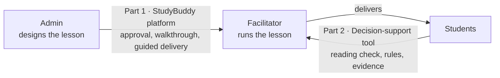

<p align="center">
  
</p>

<p align="center">
  
  
  
  
  
  
</p>

# StudyBuddy: Research Compendium

This repository is the research compendium for **Part IV Project #133**, *Making Education More Accessible and Reliable: AI-Driven Facilitator-Based Teaching*, completed in the Department of Electrical, Computer and Software Engineering at the University of Auckland in 2026.

This is a joint project in **two equal parts**, one by each student. The compendium holds everything that supports both final reports and the project portfolio: every Canvas submission, the meeting minutes, the code with its full commit history, the design records, the raw evaluation data behind every table in the reports, and a handover for whoever picks the work up next. It is written so that a future student or researcher can understand what was done, check it, rebuild it and take it further.

| | |
|---|---|
| **Students** | Moksh Manglani (`mman402`) and May Thazin (`mtha724`) |
| **Supervisor** | Professor Gill Dobbie, School of Computer Science |
| **Course** | SOFTENG 700A/B, Part IV Research Project, 2026 |
| **Canvas submission** | `133_mman402_mtha724-compendium.zip` (a zip of this repository) |
| **Part 1 code** | StudyBuddy platform, in [`03-.../04-Code`](03-Admin-Facilitator-Side_Moksh-Manglani/04-Code/) · live at [study-buddy-uoa-project.vercel.app](https://study-buddy-uoa-project.vercel.app) |
| **Part 2 code** | Facilitator decision-support tool, in [`04-.../03-Code`](04-Facilitator-Student-Side_May-Thazin/03-Code/) · original repository [mtha724/partIV-facilitator-decision-support](https://github.com/mtha724/partIV-facilitator-decision-support) |

---

## One project, two equal parts

Good teaching depends on the individual teacher, and good teachers are scarce, expensive and leave. StudyBuddy explores a **facilitator-based model of education**: a lesson is designed once by an **admin** with subject and teaching expertise, and delivered in the classroom by a **facilitator**, a person without that expertise who follows the lesson step by step. Making this work depends on two relationships, so the project was split into two equal parts, one per student, researched and built in parallel towards the same goal:

- **Part 1 (Moksh Manglani), admin and facilitator:** make sure the lesson reaches the classroom exactly as the admin designed it.
- **Part 2 (May Thazin), facilitator and students:** make sure the facilitator can see how the students in that classroom are responding, and what to do about it.



| | Part 1: The Platform | Part 2: Student Learning Insights |
|---|---|---|
| **Student** | Moksh Manglani | May Thazin |
| **Relationship** | Admin and facilitator | Facilitator and students |
| **Research question** | How can a software platform be designed so that any approved facilitator, regardless of subject expertise, delivers an expert-designed lesson as it was intended? | Can a software system convert learner interaction data into evidence-linked recommendations for facilitator decision-making? |
| **What was built** | StudyBuddy, a web platform where admins build lessons from typed blocks and approve facilitators, and facilitators walk through and deliver those lessons | A facilitator decision-support tool for Years 3 to 6 that turns a short reading check into a status, evidence and a suggested next step for each learner |
| **Folder** | [`03-Admin-Facilitator-Side_Moksh-Manglani`](03-Admin-Facilitator-Side_Moksh-Manglani/) | [`04-Facilitator-Student-Side_May-Thazin`](04-Facilitator-Student-Side_May-Thazin/) |

---

## Start here

**If you are marking this project:** each part has its own "report chapter to compendium" map, [Moksh's below](#moksh-manglani-final-report-part-1-the-platform) and [May's in her folder](04-Facilitator-Student-Side_May-Thazin/). Every figure and table in Moksh's report has its source data in [`00-Report-Figures-and-Tables`](03-Admin-Facilitator-Side_Moksh-Manglani/00-Report-Figures-and-Tables/), and May's simulation results are reproducible from her code with fixed seeds.

**If you want to run the systems:** see [Part 1: running the platform](03-Admin-Facilitator-Side_Moksh-Manglani/04-Code/) and [Part 2: running the decision-support tool and its simulation](04-Facilitator-Student-Side_May-Thazin/).

**If you are continuing the project:** read [`05-Future-Work-and-Handover`](05-Future-Work-and-Handover/) first. It lists what works, what is known, and where to start.

---

## Structure

The folders are numbered so they sort in reading order: what was handed in, then the project as a whole, then each part, then what comes next. Every folder has its own `README.md` describing what is inside and why it matters.

```text
UoA-Part-IV-Project-Research-Compendium/
│
├── README.md                                   You are here
├── LICENSE.md                                  All rights reserved
├── assets/                                     Images used by the READMEs
│
├── 01-Submissions/                             Everything submitted on Canvas, in order
│   ├── 01-Scope-and-Literature-Review/          Project scope and literature review
│   ├── 02-Mid-Year-Report/                      Moksh-Manglani/ and May-Thazin/
│   ├── 03-Conference-Presentation/              Joint slides
│   ├── 04-Display-Day-Poster/                   Joint poster
│   └── 05-Final-Report/                         Moksh-Manglani/ and May-Thazin/
│
├── 02-General/                                 Shared, project-wide records
│   ├── Meeting-Minutes/                         Every supervisor and team meeting, April to October
│   ├── Project-Document/                        The shared working document that set the scope
│   ├── System-Design-and-Planning/              Early joint system design
│   ├── Course-Resources/                        P4P handbook, rubric, report template
│   └── Project-Timeline.md                      Milestones, deadlines and pivots
│
├── 03-Admin-Facilitator-Side_Moksh-Manglani/   Part 1: the StudyBuddy platform
│   ├── 00-Report-Figures-and-Tables/            Every figure and table in the final report, with sources
│   ├── 01-Research/                             Six criteria, model comparison, benchmark
│   ├── 02-Informal-Feedback/                    Notes from feedback chats, anonymised
│   ├── 03-Design/                               Architecture, data model, lesson flow, design decisions
│   ├── 04-Code/                                 The platform source with full git history, and setup guide
│   ├── 05-Evaluation/                           Test scripts, raw results, heuristic review
│   ├── 06-AI-Use/                               What was made with AI, grouped by what it was for
│   └── 07-Ethics/                               The human ethics application and the pivot
│
├── 04-Facilitator-Student-Side_May-Thazin/     Part 2: the decision-support tool
│
└── 05-Future-Work-and-Handover/                Known issues, open questions, next steps
```

---

## Report chapter to compendium map

### Moksh Manglani: *Final Report, Part 1 (The Platform)*

| Report chapter | Where the supporting material is |
|---|---|
| 1. Introduction, 2. Project Plan | [`02-General/Project-Timeline.md`](02-General/Project-Timeline.md), [`02-General/Project-Document`](02-General/Project-Document/), [`01-Submissions/01-Scope-and-Literature-Review`](01-Submissions/01-Scope-and-Literature-Review/) |
| 3. Literature Review | [`01-Research`](03-Admin-Facilitator-Side_Moksh-Manglani/01-Research/) (criteria and Table 2 data), [`01-Submissions/01-Scope-and-Literature-Review`](01-Submissions/01-Scope-and-Literature-Review/) (the full April review) |
| 4. Research Approach | [`02-Informal-Feedback`](03-Admin-Facilitator-Side_Moksh-Manglani/02-Informal-Feedback/), [`06-AI-Use/for-code`](03-Admin-Facilitator-Side_Moksh-Manglani/06-AI-Use/for-code/) (the specifications), [`07-Ethics`](03-Admin-Facilitator-Side_Moksh-Manglani/07-Ethics/) |
| 5. System Design | [`03-Design`](03-Admin-Facilitator-Side_Moksh-Manglani/03-Design/), [`04-Code`](03-Admin-Facilitator-Side_Moksh-Manglani/04-Code/), [`06-AI-Use/for-design`](03-Admin-Facilitator-Side_Moksh-Manglani/06-AI-Use/for-design/) |
| 6. Evaluation | [`05-Evaluation`](03-Admin-Facilitator-Side_Moksh-Manglani/05-Evaluation/) (every number in Tables 4 to 7 and A1 to A3), [`02-Informal-Feedback`](03-Admin-Facilitator-Side_Moksh-Manglani/02-Informal-Feedback/) |
| 7. AI-Assisted Development | [`06-AI-Use`](03-Admin-Facilitator-Side_Moksh-Manglani/06-AI-Use/) |
| 8. Discussion, 9. Conclusions and Future Work | [`05-Future-Work-and-Handover`](05-Future-Work-and-Handover/), [`02-Informal-Feedback`](03-Admin-Facilitator-Side_Moksh-Manglani/02-Informal-Feedback/) |

### May Thazin: *Final Report, Part 2 (Student Learning Insights)*

See the map in [`04-Facilitator-Student-Side_May-Thazin/README.md`](04-Facilitator-Student-Side_May-Thazin/).

---

## Individual and joint work

The compendium is a joint submission, and the brief asks for each student's individual submissions to be clearly identified. The convention throughout is:

- A folder named `Moksh-Manglani/` or `May-Thazin/` holds that student's individual work only.
- A folder named `Joint/` holds work submitted by both students together.
- Each side of the project lives in its own top-level folder, named after the student who did it.
- Files in `01-Submissions` are the exact files submitted on Canvas, unchanged. Google Docs were exported to PDF so they are frozen as submitted.

---

## Replicating the work

| To reproduce | Go to | Time and requirements |
|---|---|---|
| The StudyBuddy platform, locally | [`03-.../04-Code`](03-Admin-Facilitator-Side_Moksh-Manglani/04-Code/) | Node 20+, a free Supabase project; optional Anthropic and Resend keys |
| The platform test results (Report Tables 6, 7, A2, A3) | [`03-.../05-Evaluation`](03-Admin-Facilitator-Side_Moksh-Manglani/05-Evaluation/) | A local production build of the platform and a seeded database |
| The decision-support tool and its simulated-classroom evaluation | [`04-.../`](04-Facilitator-Student-Side_May-Thazin/) | Node for the app; Python 3.9+ for the simulation (fixed seeds, about 6 to 7 minutes) |

---

## What is deliberately not here

Some material was left out on purpose, and its absence is not an oversight.

- **Audio recordings and transcripts of feedback chats.** These were personal notes, not research data, and one person asked not to be named. Their content is summarised, without identifying anyone, in [`02-Informal-Feedback`](03-Admin-Facilitator-Side_Moksh-Manglani/02-Informal-Feedback/).
- **Secrets.** No `.env` file, API key, database password or account password is included. The setup guides explain which keys you need and where to get your own.
- **Ethics application forms.** The formal study was replaced by informal feedback before any participant was recruited. The story of that decision is in [`07-Ethics`](03-Admin-Facilitator-Side_Moksh-Manglani/07-Ethics/).
- **Dependencies and build output** (`node_modules`, `.next`). They are rebuilt by the install step.

---

## Authors and acknowledgements

**Moksh Manglani** designed, built and evaluated the StudyBuddy platform (Part 1). **May Thazin** designed, built and evaluated the facilitator decision-support tool (Part 2). The project was supervised by **Professor Gill Dobbie**, whose weekly guidance shaped both parts. Thanks also to the practitioners and reviewers who gave their time and honest feedback.

## Licence

Copyright 2026 Moksh Manglani and May Thazin. All rights reserved. See [`LICENSE.md`](LICENSE.md). The repository is public so that it can be read, assessed and learned from; please ask before reusing any part of it.
